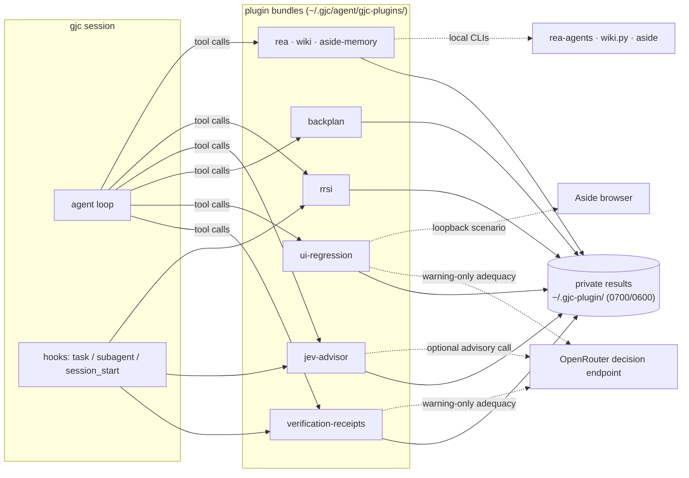

# gjc-plugin

[](https://github.com/jjongguet/gjc-plugin/actions/workflows/ci.yml)
[](https://github.com/jjongguet/gjc-plugin/releases/latest)
[](LICENSE)

Plugins for [gajae-code](https://github.com/Yeachan-Heo/gajae-code) (`gjc`) that make an agent's work checkable.

A coding agent's own report ("tests pass", "the UI works", "I followed the plan") is a claim. These plugins replace parts of that claim with evidence the agent cannot fake on its own: test runs recorded as private receipts with source freshness, browser assertions against a real page, plans validated against a fixed contract before they reach a tracker, and advisory second opinions labeled as advisory. Every plugin states what it does not prove, keeps its results in a private store, and is installable on its own.

## Plugins

| Plugin | What it gives the agent |
| --- | --- |
| [`verification-receipts`](verification-receipts/) | `verification_run` / `verification_status`: run explicit `node:test` files and keep an immutable receipt whose source freshness is recomputed on lookup. `verification_loop`: recheck that every delegated task was followed by covering verification. |
| [`ui-regression`](ui-regression/) | `ui_regression_run` / `ui_regression_status`: one bounded browser scenario against a loopback page with literal DOM assertions, recorded as a receipt. |
| [`backplan`](backplan/) | `backplan_check`: validate a backward-derived work plan (end state, observable success criteria, scoped issues) and render tracker-ready payloads with a stable digest. |
| [`jev-advisor`](jev-advisor/) | Advisory `fast` / `balanced` / `strong` tier advice before each delegated task, one-shot `jev_check` artifact checks and the read-only `plugin_metrics` report. Shadow by default; never routes models or proves quality. |
| [`rrsi`](rrsi/) | Exploration-trace store and deterministic Dream-RSI policy replay (`capture` / `import` / `dream` / `status`) with a due-gated `session_start` refresh. |
| [`rea`](rea/) | `rea_readiness` plus a workflow skill for the pinned [REA](https://github.com/morluto/rea) CLI (`rea-agents` 6.4.0). |
| [`wiki`](wiki/) | `wiki_query` over a guarded personal wiki and `wiki_propose` for pending proposals. Never approves or publishes. |
| [`aside-memory`](aside-memory/) | `aside_memory`: explicit, account-bound, read-only search over Aside memory, returned as quoted historical context. |

Measured attributes (tiers, counts, durations, journals) are descriptive observations, not quality, routing or causal proof.

## Architecture



Each bundle's generated `tools/` and `hooks/` are self-contained (sources are inlined at build time), so an installed plugin needs no sibling package. GJC owns the installed code; plugins write only to their own directory under `~/.gjc-plugin/`.

## Requirements

Common: [Bun](https://bun.sh) 1.4.x and Node.js ≥ 22 to build and test, and [gajae-code](https://github.com/Yeachan-Heo/gajae-code) (verified with 0.18.12) to install. Per plugin:

| Plugin | Surfaces | Needs | Offline / keyless |
| --- | --- | --- | --- |
| `verification-receipts` | 3 tools, 4 hooks | Node.js on `PATH` for the test runner | Yes. An optional Jev key adds warning-only adequacy notes. |
| `ui-regression` | 2 tools | The `aside` CLI with a connected profile and an explicit account; a page you serve on loopback | Runs drive a browser; `ui_regression_status` is offline. |
| `backplan` | 1 tool, loose skill | Nothing for the tool. Rendered issue bodies use Korean section headings; the optional skill registers issues through the maintainer's Linear MCP and trace helper. | Yes |
| `jev-advisor` | 3 tools, 3 hooks | `JEV_ADVISOR_API_KEY` or `OPENROUTER_API_KEY` for advice and checks | Without a key, advice is an explicit no-decision; `plugin_metrics` is offline. |
| `rrsi` | 1 tool, 1 hook | Nothing | Yes |
| `rea` | 1 tool, loose skill | Node.js `^22.19 \|\| ^24.11 \|\| >=26` or Bun; the first `npx` call downloads `rea-agents` | `rea_readiness` is offline; the CLI fetch uses the network. |
| `wiki` | 2 tools | A personal-wiki checkout with `scripts/wiki.py`, located by `WIKI_ROOT` (default `$HOME/jjongguet/personal-wiki`) | Local only |
| `aside-memory` | 1 tool | The `aside` CLI and an explicit numeric account | Network through Aside; no key |

Credentials live outside the replaceable installation tree, in `~/.gjc/agent/jev-advisor/.env` or the process environment (`JEV_ADVISOR_API_KEY` wins over `OPENROUTER_API_KEY`; process values win over the file). Never put credentials in source or result records.

## Quick start

```sh
git clone https://github.com/jjongguet/gjc-plugin
cd gjc-plugin
bun run build && bun run test
bun run demo

gjc plugin install ./backplan --user      # install any plugin the same way
gjc plugin list && gjc plugin doctor
```

Tools and hooks load when a session starts: verify a new or upgraded plugin in a fresh `gjc` process. To replace an existing installation, uninstall it first (`gjc plugin uninstall <name> --user`). When upgrading several plugins, install `jev-advisor` first and `verification-receipts` second; see [CONTRIBUTING.md](CONTRIBUTING.md#install-order-and-replacement).

Without a local `gjc`, run the chain with `SELF_IMPROVE_SKIP_SMOKE=1 bun run test`; the four host smoke guards are then skipped and reported as skipped.

## Demo

`bun run demo` drives three offline plugins through their committed tool surfaces, exactly as GJC loads them, under a temporary `HOME`. It needs no key or network and checks that your real stores are untouched. Output from a real run:

```text
$ backplan_check  (validate a work plan and render Linear-ready payloads)
  status=ok digest=184706eb9ed9… issues=1 project=reuse:docs
  incomplete plan → status=invalid; first errors: plan.end_state: required; plan.success_criteria: required; plan.project: required

$ rrsi  (capture an exploration episode, then replay policies over the store)
  status: storage=missing episodes=0
  capture: attempts=2 episodes=1
  dream: candidate policies=40 corpus attempts=2 thresholds evaluated=false (corpus_below_pass_gate)
  verdict: insufficient evidence at pass-gate size — thresholds not evaluated

$ rea_readiness  (offline readiness of the pinned REA CLI)
  rea_readiness: ready
  pinned rea-agents: 6.4.0; fetch channel: npx
  cli: npx -y rea-agents@6.4.0 <command>
  extra input → rea_readiness: invalid_input — this tool accepts exactly {} (no paths or options).

demo: ok (temporary HOME removed; real backplan/rrsi/rea stores unchanged)
```

The `rea_readiness` lines depend on the Node/npx/Bun found on your machine. A two-attempt corpus is deliberately too small for the replay thresholds; the tool says so instead of reporting a result.

## Verification

```sh
bun run build            # keyless builds for every plugin
bun run build:check      # generated surfaces are in sync with sources (non-mutating)
bun run test             # check-script fixtures, shared tests, every plugin suite, self-improve
bun run demo             # keyless end-to-end demo in a temporary HOME
bun run docs:check       # every relative Markdown link resolves
bun run evidence:check   # committed self-improve evidence has no absolute home paths
bun run policy:check     # the external-PR closer workflow keeps its safety properties
bun <plugin>/scripts/verify.ts   # one plugin's suite
```

Offline suites use disposable repositories and homes with synthetic or disabled transport; no live credential is required. CI runs these on every push to `main`. Host and browser smoke commands, and what each one does and does not prove, are in [CONTRIBUTING.md](CONTRIBUTING.md#smoke-tests).

## Private results

All plugin-owned result and state writes go to `~/.gjc-plugin/` (owned `0700` directories and single-link `0600` files; unsafe owners or modes, symlinks, hard links and corrupt inventories fail closed). Inventory, record contents and retention bounds: [docs/private-results.md](docs/private-results.md).

## Self-improvement loop

[`self-improve/`](self-improve/) is a repository-native loop that proposes edits to this repository's own declared surfaces, checks them with deterministic guards in `git archive` scratch copies, and records every decision, including every rejection, in an append-only [ledger](self-improve/ledger.jsonl). Measured campaigns and their limits are in [self-improve/evidence/](self-improve/evidence/README.md). The [Harness² comparison](self-improve/HARNESS2.md) is a research proposal, not an installed capability.

## Contributing and security

Issues are welcome; pull requests from outside the maintainers are not accepted and are closed automatically. See [CONTRIBUTING.md](CONTRIBUTING.md) for development setup and the test matrix, [docs/agent-rules.md](docs/agent-rules.md) for the repository rules, and [SECURITY.md](SECURITY.md) to report a vulnerability privately.

## License

[MIT](LICENSE)
