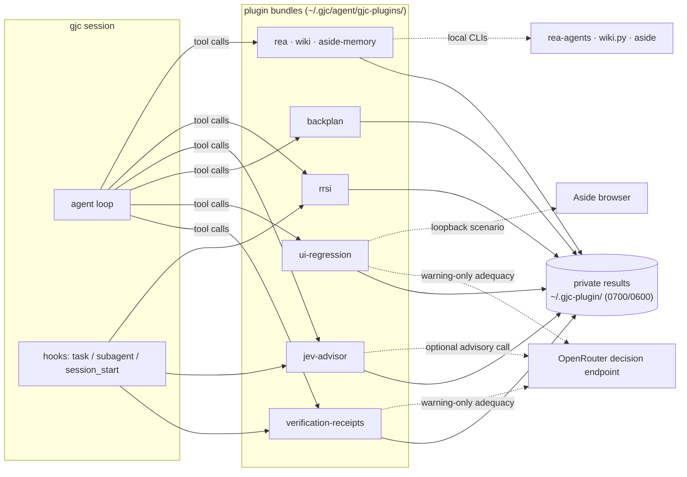

# gjc-plugin

[](https://github.com/jjongguet/gjc-plugin/actions/workflows/ci.yml)
[](https://github.com/jjongguet/gjc-plugin/releases/latest)
[](LICENSE)

**Evidence plugins for [gajae-code](https://github.com/Yeachan-Heo/gajae-code) (`gjc`) agents: receipts, checks and plans that an agent cannot fake on its own.**

A coding agent's own report ("tests pass", "the UI works", "I followed the plan") is a claim. These plugins replace parts of that claim with evidence: test runs recorded as private receipts with source freshness, browser assertions against a real page, plans validated against a fixed contract before they reach a tracker, and advisory second opinions labeled as advisory. Every plugin states what it does not prove, keeps its results in a private store, and installs on its own.

- **Start here:** [Quick start](#quick-start) installs the keyless `backplan` plugin and runs it.
- **Pick plugins:** [Choose a plugin](#choose-a-plugin) lists what each one proves and what it does not.
- **Check the claims:** [What is verified](#what-is-verified) maps the claims in this README to commands you can run.

## Quick start

You need [gajae-code](https://github.com/Yeachan-Heo/gajae-code) (`gjc`, verified with 0.18.12). Installing a plugin needs no build step: each plugin's generated tool surfaces are committed.

```sh
git clone https://github.com/jjongguet/gjc-plugin
cd gjc-plugin
gjc plugin install ./backplan --user
gjc plugin list
```

Start a **new** `gjc` session in the clone (tools load when a session starts) and ask:

> Run backplan_check with plan_path backplan/examples/valid-plan.json, then with plan_path backplan/examples/invalid-plan.json.

| Input | Expected result |
| --- | --- |
| [`valid-plan.json`](backplan/examples/valid-plan.json) | `backplan_check: ok` with a stable digest (`184706eb9ed9…` for the bundled file) and a tracker-ready issue payload |
| [`invalid-plan.json`](backplan/examples/invalid-plan.json) | `backplan_check: invalid` with the missing fields, starting `plan.end_state: required`, `plan.success_criteria: required`, `plan.project: required` |

Remove it again with `gjc plugin uninstall backplan --user`.

To check the same install → call → uninstall path without a model or key, run `node scripts/onboarding-smoke.mjs`. It installs `backplan` into a throwaway GJC user root, drives a fresh `gjc --print` process through a scripted endpoint on `127.0.0.1` that calls `backplan_check` with both examples, uninstalls the plugin, confirms a fresh process no longer lists it, and prints a JSON report. Your real GJC configuration and plugins are not used. It exits `2` with an actionable message when `gjc` or Node.js is missing or older than the verified versions.

## Choose a plugin

| Plugin | Use it to | It proves | It does not prove | Setup |
| --- | --- | --- | --- | --- |
| [`backplan`](backplan/) | Validate a work plan before it reaches a tracker and render tracker-ready payloads | The plan meets a fixed contract (observable criteria, scoped issues) and has a stable digest | That the plan is wise or that the work gets done | None: offline, keyless |
| [`verification-receipts`](verification-receipts/) | Run explicit `node:test` files as private receipts; recheck that delegated work was followed by covering verification | Which named test files ran, their counts, and whether their sources changed since | Coverage, correctness of untested code, or that the tests are meaningful | Node.js on `PATH`; keyless (an optional Jev key adds warning-only adequacy notes) |
| [`rrsi`](rrsi/) | Store exploration traces and replay deterministic policies (Dream-RSI) | What the stored corpus supports under the replay rules, including "insufficient evidence" | Online improvement; replay alone is not closed-loop efficacy | None: offline, keyless |
| [`rea`](rea/) | Check the pinned [REA](https://github.com/morluto/rea) CLI and use its workflow skill | Whether local Node/npx/Bun fit the pinned `rea-agents` 6.4.0 | The quality of REA's analysis | Node.js or Bun; the first `npx` call downloads `rea-agents` |
| [`jev-advisor`](jev-advisor/) | Get advisory `fast` / `balanced` / `strong` tier advice before delegated tasks, one-shot artifact checks and an offline metrics report | What the decision model returned, or an explicit no-decision | Model routing, task quality or correctness; shadow mode by default | `JEV_ADVISOR_API_KEY` or `OPENROUTER_API_KEY` for advice; `plugin_metrics` is offline |
| [`ui-regression`](ui-regression/) | Run one bounded browser scenario against a page you serve on loopback | The asserted DOM text and visibility in that run | Deployed UI state, visual quality, or flows you did not assert | The `aside` browser CLI with a connected profile and an explicit account |
| [`wiki`](wiki/) | Search a guarded personal wiki and file pending proposals | Canonical page matches, with citations | That a page is true; it never approves or publishes | A personal-wiki checkout with `scripts/wiki.py` (`WIKI_ROOT`) |
| [`aside-memory`](aside-memory/) | Search Aside memory read-only for an explicit account | Bounded, quoted historical context | That a memory is current or authoritative | The `aside` CLI and an explicit numeric account |

`backplan`, `verification-receipts`, `rrsi` and `rea` work for anyone with `gjc`. `jev-advisor` needs a decision-model key for its advice. `ui-regression`, `wiki` and `aside-memory` wrap the maintainer's personal tools; install them only if you run the same tools.

Measured attributes (tiers, counts, durations, journals) are descriptive observations, not quality, routing or causal proof.

## Demo

`bun run demo` drives three offline plugins through their committed tool surfaces, exactly as GJC loads them, under a temporary `HOME`. It needs no key or network and checks that your real stores are untouched. Output from a real run:

```text
$ backplan_check  (validate a work plan and render Linear-ready payloads)
  status=ok digest=184706eb9ed9… issues=1 project=reuse:docs
  incomplete plan → status=invalid; first errors: plan.end_state: required; plan.success_criteria: required; plan.project: required

$ rrsi  (capture an exploration episode, then replay policies over the store)
  status: storage=missing episodes=0
  capture: attempts=2 episodes=1
  dream: candidate policies=40 corpus attempts=2 thresholds evaluated=false (corpus_below_pass_gate)
  verdict: insufficient evidence at pass-gate size — thresholds not evaluated

$ rea_readiness  (offline readiness of the pinned REA CLI)
  rea_readiness: ready
  pinned rea-agents: 6.4.0; fetch channel: npx
  cli: npx -y rea-agents@6.4.0 <command>
  extra input → rea_readiness: invalid_input — this tool accepts exactly {} (no paths or options).

demo: ok (temporary HOME removed; real backplan/rrsi/rea stores unchanged)
```

The `rea_readiness` lines depend on the Node/npx/Bun found on your machine. A two-attempt corpus is deliberately too small for the replay thresholds; the tool says so instead of reporting a result.

## How it works



Each bundle's generated `tools/` and `hooks/` are self-contained (sources are inlined at build time), so an installed plugin needs no sibling package. GJC owns the installed code; plugins write only to their own directory under `~/.gjc-plugin/`.

## Requirements

Installing and using a plugin needs only `gjc` (verified with 0.18.12). Building and testing this repository also needs [Bun](https://bun.sh) 1.4.x and Node.js 22 or newer. Maintainers run macOS and CI runs Linux; Windows is untested.

| Plugin | Surfaces | Needs | Offline / keyless |
| --- | --- | --- | --- |
| `verification-receipts` | 3 tools, 4 hooks | Node.js on `PATH` for the test runner | Yes. An optional Jev key adds warning-only adequacy notes. |
| `ui-regression` | 2 tools | The `aside` CLI with a connected profile and an explicit account; a page you serve on loopback | Runs drive a browser; `ui_regression_status` is offline. |
| `backplan` | 1 tool, loose skill | Nothing for the tool. Rendered issue bodies use Korean section headings; the optional skill registers issues through the maintainer's Linear MCP and trace helper. | Yes |
| `jev-advisor` | 3 tools, 3 hooks | `JEV_ADVISOR_API_KEY` or `OPENROUTER_API_KEY` for advice and checks | Without a key, advice is an explicit no-decision; `plugin_metrics` is offline. |
| `rrsi` | 1 tool, 1 hook | Nothing | Yes |
| `rea` | 1 tool, loose skill | Node.js `^22.19 \|\| ^24.11 \|\| >=26` or Bun; the first `npx` call downloads `rea-agents` | `rea_readiness` is offline; the CLI fetch uses the network. |
| `wiki` | 2 tools | A personal-wiki checkout with `scripts/wiki.py`, located by `WIKI_ROOT` (default `$HOME/jjongguet/personal-wiki`) | Local only |
| `aside-memory` | 1 tool | The `aside` CLI and an explicit numeric account | Network through Aside; no key |

Credentials live outside the replaceable installation tree, in `~/.gjc/agent/jev-advisor/.env` or the process environment (`JEV_ADVISOR_API_KEY` wins over `OPENROUTER_API_KEY`; process values win over the file). Never put credentials in source or result records.

## Troubleshooting

| Symptom | Cause and fix |
| --- | --- |
| `gjc: command not found` | gajae-code is not installed or not on `PATH`. Install it from [gajae-code](https://github.com/Yeachan-Heo/gajae-code); `node scripts/onboarding-smoke.mjs` reports the missing prerequisite and exits `2`. |
| `gjc plugin install` refuses because the plugin is already installed | Replace it: `gjc plugin uninstall <name> --user`, then install again. |
| An installed tool is missing from the session | Tools and hooks load when a session starts. Start a new `gjc` process, then check `gjc plugin list` and `gjc plugin doctor`. |
| `jev_advise` or `jev_check` returns `no_decision` with reason `disabled` | No decision-model key is configured. This is the documented keyless behaviour; add `JEV_ADVISOR_API_KEY` or `OPENROUTER_API_KEY` to enable advice. |
| A metrics or journal read fails with `store_corrupt` after upgrading several plugins | An older `jev-advisor` read records written by a newer `verification-receipts`. Reinstall `jev-advisor` first, `verification-receipts` second, then the rest ([install order](CONTRIBUTING.md#install-order-and-replacement)). |
| `ui_regression_run` fails before a page opens | The `aside` CLI is missing or not connected, or no explicit account was passed. `ui_regression_status` still works offline. |
| `bun run test` fails on host smoke guards without a local `gjc` | Run `SELF_IMPROVE_SKIP_SMOKE=1 bun run test`; the four host smoke guards are then reported as skipped, not passed. |

## Develop and verify

```sh
bun run build            # keyless builds for every plugin
bun run build:check      # generated surfaces are in sync with sources (non-mutating)
bun run test             # check-script fixtures, shared tests, every plugin suite, self-improve
bun run demo             # keyless end-to-end demo in a temporary HOME
bun run onboarding:smoke # README quick start in a throwaway GJC root (needs gjc)
bun run docs:check       # every relative Markdown link resolves
bun run evidence:check   # committed self-improve evidence has no absolute home paths
bun run policy:check     # the external-PR closer workflow keeps its safety properties
bun <plugin>/scripts/verify.ts   # one plugin's suite
```

Offline suites use disposable repositories and homes with synthetic or disabled transport; no live credential is required. CI runs the offline checks on every push to `main`. Host and browser smoke commands, and what each one does and does not prove, are in [CONTRIBUTING.md](CONTRIBUTING.md#smoke-tests).

### What is verified

| Claim in this README | Evidence you can run or read |
| --- | --- |
| Generated tools and hooks match their sources | `bun run build:check` |
| Every plugin suite passes offline, without credentials | `bun run test` |
| The quick start works in a fresh `gjc` process | `bun run onboarding:smoke` |
| The demo output above is real | `bun run demo` |
| CI never runs pull-request code automatically | `bun run policy:check` and [`.github/workflows/`](.github/workflows/) |
| Self-improvement campaigns and their limits | [self-improve/evidence/](self-improve/evidence/README.md) |

Nothing in this repository establishes that these plugins improve agent outcomes in general, or that people other than the maintainer need them. [ADR 0001](docs/adr/0001-public-adoption-and-evaluation.md) records how such claims are evaluated before they are made.

## Private results

All plugin-owned result and state writes go to `~/.gjc-plugin/` (owned `0700` directories and single-link `0600` files; unsafe owners or modes, symlinks, hard links and corrupt inventories fail closed). Inventory, record contents and retention bounds: [docs/private-results.md](docs/private-results.md).

## Self-improvement loop

[`self-improve/`](self-improve/) is a repository-native loop that proposes edits to this repository's own declared surfaces, checks them with deterministic guards in `git archive` scratch copies, and records every decision, including every rejection, in an append-only [ledger](self-improve/ledger.jsonl). Measured campaigns and their limits are in [self-improve/evidence/](self-improve/evidence/README.md). The [Harness² comparison](self-improve/HARNESS2.md) is a research proposal, not an installed capability.

## Contributing and security

Issues are welcome; pull requests from outside the maintainers are not accepted and are closed automatically. See [CONTRIBUTING.md](CONTRIBUTING.md) for development setup and the test matrix, [docs/agent-rules.md](docs/agent-rules.md) for the repository rules, and [SECURITY.md](SECURITY.md) to report a vulnerability privately.

## License

[MIT](LICENSE)
